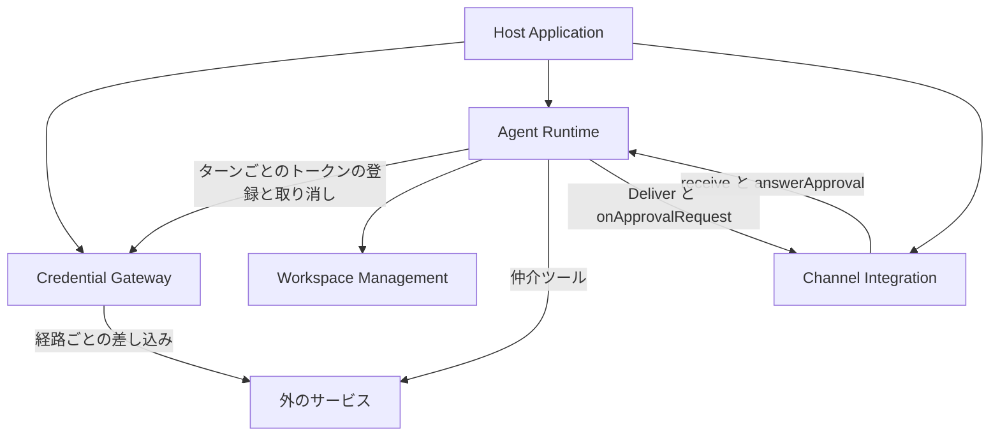

# Host Application の調査（2026-11-28）

目的: Agent Runtime と Sandbox ができた Kurumi を、利用者が日常で使えるアプリケーションとして動かすために何が足りないかを洗い出し、後続の Grill with Docs で議論する論点と開発順序を並べる。ここでは設計を決めない。

根拠の印は次のとおりである。

- 【コード path:line】Kurumi か NanoClaw のソースから読んだもの。
- 【実測】`docs/research/agent-boundary/REPORT.md`（以下 境界 REPORT）が試作で観測したもの。節番号を添える。実測はすべて Docker Desktop for Mac のもので、Linux では流していない。
- 【推論】観測もコードもなく、上の事実から導いたもの。
- 【提案】この文書の提案。境界 REPORT の推奨案は【境界 REPORT の推奨】と書き、確定事項として扱わない。

使った版: Kurumi `c91dc37`、NanoClaw の fork（`~/.ghq/src/github.com/ashigirl96/nanoclaw`）`9fbee967`。fork の main は、ホストのライフサイクルとメッセージの流れの中心部（router、delivery、container-runner、poll-loop）を upstream から変えていない。差分は Slack、Codex、OneCLI などの追加だけである。

## 1. 結論

1. Agent Runtime は、受信、応答、追加指示、停止、承認、回復を API として揃えている。それを本番で呼ぶ組み立て役が `apps/host` にない【コード `apps/host/src/main.ts:9-21`】。組み立ての見本は開発用の `try.ts` にある【コード `packages/agent-runtime/src/real/try.ts:145-170`】。
2. `try.ts` が使う開発用の中継は、本番に持ち込めない。どのパスにも本物の資格情報を付けて流し、ホストが死んだ後も古いコンテナの要求を通し続ける【実測、境界 REPORT 3 節・5 節 U6】。
3. `PreToolUse` の関所は、コンテナの中でコードを実行する攻撃者に対しては境界にならない【実測、境界 REPORT 2 節】。ただし、ツールの結果に誤導された正常な CLI の誤操作を止める緩和策としての価値は残る【境界 REPORT 2 節・11 節】。
4. 【提案】日常利用の開始には、Linux の本番機での隔離の確認を必須の条件とする。境界 REPORT のネットワークの結論は、すべて Mac のものである。
5. 【提案】開発順序は 8 節のとおりである。二重起動の防止は Host Application の正式な組み立てに含め、Agent（エージェント）と作業場所の基本的な関係は Channel Integration の前に整理する。

## 2. 調べ方

- Kurumi の `apps/host` と `packages/agent-runtime` を読んだ。
- NanoClaw の fork のホスト側を、ホストのライフサイクルと状態の管理、メッセージの流れとインターフェースの 2 つに分けて読んだ。NanoClaw の行番号はこの読み取りによるもので、そのうち 2 つを自分で確かめた。`getActiveContainerCount` はテスト以外から呼ばれていない【コード `src/container-runner.ts:216`】。`src` に `/stop` という文字列はない。
- 境界 REPORT と突き合わせた。

## 3. 5 つの領域の現状

### 3.1 ホストプロセスの起動、常駐、終了、再起動、障害復旧

Kurumi にあるもの:

- SIGINT と SIGTERM で全体の処理を中断する【コード `apps/host/src/main.ts:27-29`】。
- 中断したターンは `host_stopped` として閉じ、コンテナはターンの後始末で `docker rm -f` する【コード `packages/agent-runtime/src/turn.ts:263-293, 510-535`】。
- 起動時の回復がある。ラベル付きのコンテナを消し、未完了の Turn（ターン）を Interrupted Turn（中断されたターン）として閉じ、`sending` の送信を `pending` に戻し、待っている受信があるセッションを起こす【コード `packages/agent-runtime/src/recovery.ts:12-27`】。

Kurumi にないもの:

- 二重起動の防止。起動時の掃除は `kurumi.agent=1` の付いたコンテナを全部消す【コード `packages/agent-runtime/src/sandbox.ts:136-141`】。2 つ目のホストは 1 つ目のターンを殺し、同じ SQLite に 2 つのプロセスが書く【推論】。
- 起動前の確認。Docker、イメージ、ゲートウェイの有無は、最初のターンで初めて失敗として出る。`try.ts` だけがイメージの有無を見る【コード `try.ts:31-36`】。
- 停止にかける時間の上限と、常駐の設定（launchd、systemd）。

NanoClaw との比較:

- NanoClaw はホストを再起動してもコンテナを止めず、次の起動で引き取り直す【コード `src/container-runner.ts:916-1015`】。そのため 30 分の心拍と 60 秒ごとの見回りを持つ【コード `src/reconcile-session.ts:64-133`】。Kurumi はターンごとにコンテナを捨て（ADR-0002）、やり直さない（ADR-0003）ので、引き取りも見回りも要らない【推論】。
- 常駐は launchd の `KeepAlive` と systemd の `Restart=always` に任せる【コード `setup/service.ts:306-604`】。
- 二重起動は管理用ソケットの生存で検出するが、ソケットはチャンネル接続とマイグレーションの後に開く【コード `src/index.ts:62-196`、`src/cli/socket-server.ts:47`】。そのため 2 つ目のプロセスは、検出される前に接続とマイグレーションを済ませる。

### 3.2 設定、永続化データ、作業場所

Kurumi にあるもの: 設定は `KURUMI_DB_PATH` だけ【コード `apps/host/src/main.ts:11-13`】。表は 5 つ【コード `packages/agent-runtime/src/schema.ts`】。作業場所は `dataDir/sessions/<id>/{cfg,work}`【コード `packages/agent-runtime/src/runtime.ts:152-165`】。

Kurumi にないもの:

- `RuntimeConfig`（Runtime に渡す設定の型）の値の出どころ。`dataDir`、`agent`、Docker の設定の読み込み先がない。イメージのタグは `real/dev-env.ts:9` にしかない。
- エージェントへの指示を渡す道。`agent` はただの文字列で【コード `runtime.ts:54`】、SDK の呼び出しは `settingSources: []` で、`systemPrompt` を渡さない【コード `turn.ts:512-520`】。

食い違い: 作業場所がセッションごとにある。`/new` は新しいセッションを作り、空の作業場所から始める【コード `runtime.ts:182-191`】。用語集は Agent を「指示、作業場、権限をひと組にした主体」と定義しており、作業場所はエージェントに属すると読める。作業場所の語は用語集にない。

NanoClaw との比較: `groups/<folder>/` に `CLAUDE.md` を起動のたびに組み直してマウントする【コード `src/group-init.ts:28`、`src/container-runner.ts:1173-1384`】。Kurumi では作業場所と `/cfg` に仕込んだ設定は効かないことを確かめてあり、それは意図した防御である【コード `packages/agent-runtime/src/real/README.md`】。そのため指示は、ホストが SDK の `systemPrompt` で渡す形が ADR-0001 と合う【推論】。

### 3.3 Agent Runtime の初期化とライフサイクル

Kurumi にあるもの: `Runtime.layer` は作られるときに回復と配信ループを始める。ターンは全体で 3 つまで、セッションごとに 1 つまで並び、制限時間は 30 分である【コード `runtime.ts:89-111, 244-249`】。

Kurumi にないもの: `apps/host` での層の組み立て、本番の `DockerConfig`、ゲートウェイの起動と停止。issue #6（コンテナ同士が同じ `--internal` ネットワークで届く）と #9（Linux での隔離の確認）が開いている。

NanoClaw との比較: 全体のコンテナ数に上限がない【コード `src/container-runner.ts:216`、呼び出し元なし】。取り入れるものはない【推論】。

### 3.4 受信、応答、追加指示、停止、承認

Kurumi にあるもの:

- `receive` は DB に確定してから返り、チャンネルはそれを待って受信を確認する【コード `runtime.ts:48, 204-237`】。重複は `(channel, platform_message_id)` の一意制約で除く【コード `schema.ts:70`】。
- ターンの途中の Inbound Message（受信メッセージ）は、動いているターンに押し込む（ADR-0002）。
- `/stop` と `/new` はホストが解釈する【コード `runtime.ts:207`】。
- Outbound Message（送信メッセージ）は `pending`、`sending`、`delivered` と進め、少なくとも 1 回届ける【コード `packages/agent-runtime/src/outbound.ts`】。
- Approval Request（承認依頼）は `onApprovalRequest`、`answerApproval`、`policy` で扱う【コード `packages/agent-runtime/src/gate.ts`、`runtime.ts:239-242`】。

Kurumi にないもの:

- `receive` を呼ぶ本番の受信元と、`Deliver` の実装。
- 送り主の確認。`sender` は保存されるが、どこでも検査されない【コード `runtime.ts:39-46`】。
- 承認依頼の表示と、返事から依頼の `id` への対応づけ。`try.ts` の y/n だけがある【コード `try.ts:98-115`】。
- 承認の判定は既定で全許可である【コード `runtime.ts:107`】。

NanoClaw との比較:

- 受け取ったメッセージを DB に書く前に、待たない promise で振り分ける【コード `src/index.ts:96-118`】。Kurumi の確定してから返る契約の方が、落ちたときに受信を失わない【推論】。
- 利用者が使える停止コマンドはない。ツールごとの承認もなく、コンテナは `bypassPermissions` で動く。承認はホスト側の操作にだけかかる【コード `src/approvals/primitive.ts:242-310`】。

### 3.5 インターフェースとの責務分担

境目は Kurumi の契約で決まっている。受信は `receive(InboundInput)`、送信はチャンネル名ごとの `Deliver`、承認は `onApprovalRequest` と `answerApproval` である【コード `runtime.ts:51-75`】。チャンネルが持つのは、通信と認証、ID の対応づけ、確定後の受信確認、長文の分割と書式、承認依頼の表示と答えの対応づけである。送り主の確認をホストとチャンネルのどちらに置くかは決まっていない。

NanoClaw は、受け口の自己登録、会話とエージェントの結びつけの表、利用者ごとの権限、運用者向けの 2 つのソケット（チャット用の `data/cli.sock` と管理用の `data/ncl.sock`）を持つ【コード `src/channels/channel-registry.ts:29`、`src/router.ts:219-459`、`src/cli/socket-server.ts`】。個人利用、単一ホストの前提では、どれもまだ要らない【推論】。

最初のチャンネルの選択肢を比べる【推論】。

| 選択肢 | 得るもの | 払うもの |
| --- | --- | --- |
| 前面で起動し、標準入力を 1 つの会話にする（`try.ts` の形） | 外部の資格情報もプロセス間の通信も要らない | 常駐と両立しない。開発用 |
| ローカルのソケットと小さなクライアント | 常駐したホストに話しかけられる | 独自の通信手順を保守する |
| チャットサービスの受け口 | 実際に使える。承認のボタンを作りやすい | 資格情報、外部への依存、受信の方式の選択 |

## 4. 信頼境界の調査が既存の設計に与える影響

### 4.1 境界 REPORT の事実

| # | 事実 | 出典 |
| --- | --- | --- |
| F1 | コンテナの中で任意のコードを実行する攻撃者（T2）に対して、関所は境界にならない。Bash の子が CLI の標準出力に書けば、ホストは CLI の出力と区別しない | 【実測】2 節 |
| F2 | 標準入出力の偽造で、攻撃者は `tool_calls` の行、承認依頼の文面と回数、途中経過、最後の文、`claude_session_id`、Session（セッション）を `lost` にすること、中断の知らせの枠の中の文を決められる | 【実測】2 節 |
| F3 | T2 に効く強制点は `--internal` のネットワーク、Credential Gateway（資格情報ゲートウェイ）、ホストが自分で実行する副作用（境界 REPORT の語で仲介ツール）の 3 つだけである | 【実測】1 節 |
| F4 | 関所に残る役目は 2 つある。ツールの結果に誤導された正常な CLI（T1）への方針と記録、ホストが実行する副作用の入口である。T1 では、コンテナの中のツールへの承認が作業場所の破壊を止める | 2 節・11 節 |
| F5 | 線の上の 15 分の保留を待てたのは curl、git、gh だけだった。メソッドとパスに結び付けた承認は、本文の差し替え 8 組を 1 つも捕まえなかった | 【実測】5 節 U4・U5 |
| F6 | 仲介ツールの承認は、解析済みの引数に結び付ければ入れ替えられなかった。ツール呼び出しの id に結び付けると入れ替えられた | 【実測】5 節 U10 |
| F7 | ホストのプロセスの中のゲートウェイは、取り消しが 1 ms 未満で、ホストが死ぬと止まった。別プロセスのゲートウェイは、ホストの死の後も古いコンテナの要求を通した。`docker run -i --rm` のコンテナはホストの死の後も動き続けた | 【実測】5 節 U6 |
| F8 | 開発用の中継は、接頭辞 `kurumi-fake-` のどのトークンも通し、どのパスにも本物の資格情報を付ける。入力を返す上流からは、本物の資格情報がコンテナに戻った | 【実測】3 節 |
| F9 | イメージに git、gh、curl、npm、pip がない。`HOME=/` と読み取り専用の root では npm の cache に書けない | 【実測】7 節 |
| F10 | 攻撃者は承認依頼を上限なく出せた（6 回）。途中経過の件数を抑える処理もない | 【実測】5 節 U10・2 節 |

### 4.2 既存の ADR と実装への影響

| 対象 | 影響 | 印 |
| --- | --- | --- |
| ADR-0001 | 構成は揺らがない。強制点のうち 2 つはこの構成を前提にする。ただし「ツールの許可判定を SDK のまま使える」利点は、T1 にだけ効く緩和策になる。標準入出力の解析は信頼境界になる | 【推論】F1・F2・F4 から |
| ADR-0002 | 偽の `result` でターンを先に閉じられ、本物の答えが届かない。可用性の問題である | 【実測】2 節 |
| ADR-0004 | 「会話記録は安全の判断に使わない」は F1 と合う。ただし `tool_calls` も偽の `hook_callback` で書ける。知らせの枠は、コンテナが書いたツールの入力を引用する【コード `turn.ts:252`】。境界 REPORT の I11（コンテナの文がホストの文に見えない）に反する | 【実測】【コード】 |
| ADR-0005 | 冪等キーで配達を消したり二重にしたりはできない。途中経過は上限なく届き、T2 では最後の文も攻撃者のものになる | 【実測】2 節 |
| ADR-0006 | 偽の `is_error` の `result` で Session を `lost` にできる。`claude_session_id` は検査されないままパスに使われる【コード `transcript.ts:26`】 | 【実測】【コード】 |
| ADR-0007 | 影響が最も大きい。コンテナの中のツールへの承認は T2 には効かず、T1 にだけ効く（F1、F4）。線の上の承認は保留にクライアントが耐えない（F5）。T2 にも効く承認は、仲介ツールで引数に結び付けたものだけである（F6）。仲介ツールの呼び出しで 15 分待てるかは測っていない | 【実測】【推論】 |
| ADR-0008、ADR-0009 | 影響はない | 【推論】 |
| 用語集の Credential Gateway | 定義は承認と監査を含む。境界 REPORT の推奨の C' では、承認は仲介ツールに移る。仲介ツールに当たる語はない | 【コード `GLOSSARY.md`】【推論】 |
| `RuntimeConfig.credentialGateway` | ターンごとのトークンの登録口はある【コード `runtime.ts:59`、`turn.ts:330`】。取り消す口はない | 【コード】 |
| 承認依頼の表示 | `ApprovalRequest.input` を切らずに見せる【コード `gate.ts:19-20`】。コンテナの中のツールでは、入力はすべてコンテナが書いたもので、`description` のような説明文も含む | 【コード】 |

## 5. PreToolUse の関所の位置づけ

関所は T2 に対する境界ではない（F1）。一方で、関所を外すと T1 への守りも失う（F4）。境界 REPORT は、T2 だけを脅威に置くと T1 に効く関所まで捨てる設計を招く、と書いている（2 節）。

いまの関所が T1 に対して持つ働きは次の 3 つである。

- 方針: `policy` がツール名と入力から `allow`、`deny`、`ask` を返す。既定は全許可である【コード `gate.ts:8`、`runtime.ts:107`】。
- 禁止: Cron などのツールは方針より先に拒む【コード `gate.ts:24-35, 99-101`】。
- 先書きの記録: 許可する前に `tool_calls` に書き、中断の知らせに使う（ADR-0004）。

緩和策として残す場合の費用は次のとおりである【推論】。

- T2 では、承認依頼の文面も回数も攻撃者が決める（F2、F10）。人に見せる表示は、エージェントの申告であることが分かる形にしないと、ホストの保証に見える。
- 承認を求めすぎると、人は中身を読まずに答えるようになる。
- 仲介ツールに承認を足したとき、関所でも問うと 1 回の操作で 2 回問う（境界 REPORT I8）。境界 REPORT は、関所では仲介ツールを `allow` にすることを推す（9 節）。

【提案】関所は「正常な CLI の誤操作を止める緩和策」として残し、ADR と用語集にその位置づけを書く。T2 への守りは F3 の強制点に任せる。何を `ask` や `deny` にするか、承認依頼の表示をどう書き分けるかは Grill with Docs に委ねる（8.1 節の論点 A と C）。

## 6. 5 つの領域の責務と依存関係

この節は【提案】である。境界 REPORT の推奨の C'（資格情報で分ける共存）を仮に置いた分担で、C' の採否は 8.1 節の論点 A と B で決める。

| 領域 | 受け持つこと | 依存する先 | いまの状態 |
| --- | --- | --- | --- |
| Host Application | 組み立て、起動と停止、二重起動の防止、起動前の確認、常駐。設定と秘密の読み出し。ゲートウェイ、Runtime、チャンネルの寿命をそろえる | ほかの 4 つすべて | `main.ts` は DB だけ。見本は `try.ts` |
| Credential Gateway | ターンごとのトークンの登録と取り消し、経路の許可リスト、経路ごとの資格情報の差し込み、要求の記録 | 秘密、方針の表、トークンの登録 | 開発用の中継だけで、本番には使えない（F8） |
| Agent | ターン、Session、受信と送信、関所、承認の待ち、回復。エージェントの指示と権限。仲介ツールはホストの MCP として送るツールの隣に置く | Sandbox、ゲートウェイの登録と取り消し、方針の表、チャンネルの API、作業場所 | ターンの実行はある。指示と権限はない |
| Workspace Management | 作業場所と `CLAUDE_CONFIG_DIR` の配置と寿命。イメージの道具。ホストが作業場所を読むときの規則 | Agent の定義（どの単位で持つか） | セッションごと。用語集と食い違う |
| Channel Integration | 通信、送り主の確認、ID の対応づけ、確定後の受信確認、送信と承認依頼の表示、答えの対応づけ。ホストの文とエージェントの文の書き分け | Agent Runtime の API だけ | `try.ts` のターミナルだけ |

依存について 3 点を書く。

1. 【推論】ゲートウェイの寿命をホストにそろえることは、境界 REPORT の I5（ターンの後とホストの死の後にトークンが使えない）と I10（落ちたら閉じる）を構成で守る条件である（F7）。ゲートウェイの置き場所は Host Application の設計と切り離せない。
2. 【実測】Mac ではコンテナからホストのプロセスに届かないので、境界 REPORT は TCP の中継を 1 つ挟んで測った（5 節 U6）。Linux でホストのブリッジの番地に bind できるかは確かめていない（10 節）。
3. 【推論】チャンネルは承認依頼の表示とセッションの単位を前提にする。Agent と作業場所の関係（Session ごとか、エージェントごとか）が決まらないと、`/new` の意味と、チャンネルが見せる文面が決まらない。

## 7. 見直す判断と未解決の課題

### 7.1 見直す候補

| # | 判断 | 理由 | 重さ |
| --- | --- | --- | --- |
| R1 | ADR-0007 の承認の位置づけ | 承認を 2 種類に分けて書く必要がある。コンテナの中のツールへの承認は T1 への緩和策で、仲介ツールの承認は引数に結び付く強制である（5 節） | 大。用語集の Approval Request と Credential Gateway に及ぶ |
| R2 | ADR-0004 の中断の知らせ | `tool_calls` は攻撃者も書ける申告である。枠がコンテナの文を引用する | 小 |
| R3 | ADR-0005 の途中経過 | 件数に上限がない（F10） | 小 |
| R4 | ADR-0006 と `transcript.ts` | `claude_session_id` を UUID として検査しない。偽の `result` で `lost` にされる | 小。`lost` にされることを許すかは判断が要る |
| R5 | 承認依頼の表示（`gate.ts`） | コンテナの書いた入力をホストの依頼として見せる | 中。R1 の結論しだい |
| R6 | 用語集の Credential Gateway | C' を採るなら、承認を定義から外し、仲介ツールの語を足す | 小。論点 B の結論待ち |
| R7 | 開発用の中継を暫定の通り道にする案 | F7、F8 | この文書では採らない |

ADR-0001、0002、0003、0008、0009 の決定は、境界 REPORT の事実と食い違わない。ADR-0002 の可用性の問題は、T2 では最後の文がもともと攻撃者のものなので、対策を足しても得るものが小さい【推論】。

### 7.2 未解決の課題

| # | 課題 | 材料 | 状態 |
| --- | --- | --- | --- |
| Q1 | 最初の版で外に出す資格情報 | 境界 REPORT 11 節。モデルだけか、読み取り専用を足すか | 利用者が決める |
| Q2 | 秘密の置き場所と読み出し方 | 境界 REPORT 9 節はホストに置くことを推す。ファイル、OS の鍵束、外部の保管庫のどれかは未定 | 未決 |
| Q3 | ゲートウェイの置き場所と、Mac と Linux の通り道 | F7。Linux の bind は未確認 | 未確認 |
| Q4 | 関所で `ask` や `deny` にするもの、承認依頼の表示、件数の上限 | 5 節、R1、R5、境界 REPORT I8・I13 | 未決 |
| Q5 | Session の間の隔離（境界 REPORT I12） | Session ごとにトークンと経路を分ければ構成で守れるが、試していない。issue #6 とつながる | 未確認 |
| Q6 | 作業場所の単位とイメージの道具 | 3.2 節の食い違い、F9。git push を仲介ツールで行うと、ホストが攻撃者の作業場所で git を動かす（境界 REPORT 11 節） | 未決 |
| Q7 | エージェントへの指示の渡し方 | 作業場所や `/cfg` の設定はホストの文として扱えないので、`systemPrompt` で渡す形が合う | 【推論】 |
| Q8 | WebFetch と、資格情報を付けない外向きの経路 | 既定では事前確認が `api.anthropic.com` に直接行って壊れる。任意のサイトを読む経路は持ち出しの通り道になる（境界 REPORT 7 節） | 利用者が決める |
| Q9 | 仲介ツールの呼び出しで 15 分の承認待ちが成り立つか | Claude Code が MCP の呼び出しを待つ時間は測っていない | 未確認 |
| Q10 | Linux の本番機での隔離（issue #9） | 境界 REPORT のネットワークの結論と `docs/linux-isolation-check.md` の項目は、すべて Mac でしか確かめていない | 未確認。8 節で日常利用の条件にする |

## 8. 論点と開発順序

この節は全体が【提案】である。

### 8.1 考え方

- 【推論】日常利用で守る資格情報がモデルのトークンだけなら、要る強制点はネットワークとゲートウェイの 2 つになる。仲介ツールと承認の作り直し（R1 のうち仲介ツールの側）は、書き込める資格情報を渡す段階まで後に回せる。
- 【推論】その版でも、攻撃者の文は人に届く（F2）。チャンネルを手元の外へ広げる前に、ホストの文とエージェントの文の書き分けと、件数の上限を入れる。人を疲れさせる攻撃は、届く先が増えるほど効く（境界 REPORT 10 節）。
- 【実測】モデルの経路もデータを運べる（境界 REPORT 10 節）。資格情報を絞っても持ち出しの危険は残る。
- ネットワークによる強制は、Linux で確かめるまで本番機で成り立つと言えない（Q10）。そのため Linux での確認を日常利用の前の必須の条件にし、ゲートウェイの通り道（Q3）の判断にも使えるよう、早い段階で行う。

### 8.2 Grill with Docs で扱う論点

| 順 | 論点 | 決めること | 先に置く理由 |
| --- | --- | --- | --- |
| A | 日常利用の安全の線 | 外に出す資格情報（Q1）、許す残りのリスク（境界 REPORT 10 節）、WebFetch（Q8）、関所を緩和策として残す範囲（5 節、Q4） | ほかの論点の範囲がこれで決まる |
| B | ゲートウェイの置き場所と最小の形 | ホストの中に置くか（F7）、通り道（Q3）、トークンの登録と取り消し、経路の許可リスト、秘密（Q2）、用語集の Credential Gateway（R6） | 中継を本番に持ち込めない（F8） |
| C | ホストの文の扱い | 中断の知らせ（R2）、件数の上限（R3）、`claude_session_id` の検査（R4）、承認依頼の表示（R5） | A と B に依存せず小さく直せる。チャンネルが見せる内容を決める |
| D | Host Application の組み立て | 二重起動の防止、起動前の確認、設定の読み方、停止の上限 | B の結論でゲートウェイの寿命の扱いが決まる |
| E | Agent と作業場所の基本的な関係 | 作業場所の単位と `/new` の意味（Q6）、指示の渡し方（Q7）、イメージの道具（F9） | チャンネルが前提にするセッションの単位と文面を決める（6 節の 3 点目） |
| F | Channel Integration | 最初のチャットサービス、送り主の確認、承認依頼の表示と答え | C と E の結論を使う |
| G | 仲介ツールと書き込める資格情報 | R1 のうち仲介ツールの側、方針の表、承認の結び付け（F6）、Q5、Q9 | 外のサービスへの書き込みを使いたくなった時点で着手する |

### 8.3 開発順序

各段階は確認で終える。

1. Linux の本番機で隔離を確かめる。`docs/linux-isolation-check.md` の項目（issue #9）と、境界 REPORT の試作（`run-all.sh`）を流し直す。確認は、Mac での結論（DNS が外へ転送されない、ホストと LAN に届かない）が Linux でも成り立つこと、ホストのブリッジの番地に bind できるかが分かることである。結果は論点 B の材料にする。
2. ホストの文の扱い（論点 C）を `packages/agent-runtime` に入れる。確認は、境界 REPORT の前提の試作（`prototypes/premise/`）で、中断の知らせの枠と件数の上限の観測が変わることである。
3. ホストの中に、モデルの経路だけの最小のゲートウェイを作る（論点 B）。トークンの取り消し口を `RuntimeConfig` に足す。確認は、境界 REPORT の U6 と U9 の試作で、取り消し、ホストの死、反射が観測どおりになることである。
4. Host Application を正式に組み立てる（論点 D）。`try.ts` の組み立てを `apps/host` に移し、中継を 3 のゲートウェイに置き換え、二重起動の防止、起動前の確認、設定の読み込みを入れる。確認は、1 往復、`/stop`、`kill -9` からの回復、2 つ目の起動が断られること、Docker やゲートウェイがないと起動が止まることである。
5. Agent と作業場所の基本的な関係を実装する（論点 E）。確認は、決めた単位どおりに `/new` が作業場所を扱い、ホストが渡した指示がエージェントに効くことである。
6. Channel Integration を 1 本作る（論点 F）。確認は、手元の端末以外から 1 往復でき、承認依頼がホストの解析した項目と、エージェントの申告と分かる部分に書き分けて表示されることである。
7. Linux の本番機で常駐させる（systemd の利用者単位の設定）。確認は、プロセスを kill すると起き直り、回復が流れることである。1 と 7 が済んだ時点を、日常利用の開始とする。
8. 仲介ツールと書き込める資格情報（論点 G）。

## 9. 確かめていないこと

- NanoClaw の Telegram と WhatsApp の受け口、`docker-driver.ts` の中身、ゲートウェイの実装は読んでいない。
- この文書の Kurumi と NanoClaw についての記述は、ソースを読んだものである。本物の Docker での動作は、境界 REPORT の実測の範囲でしか確かめていない。
- Claude Code が MCP の呼び出しを何秒まで待つか（Q9）。
- Linux での全部（Q10）。
